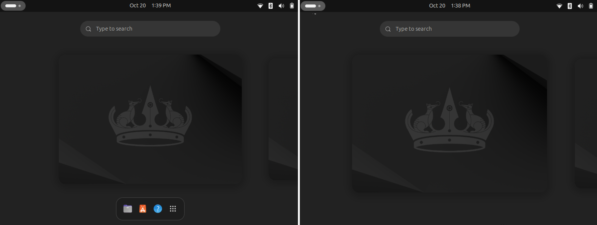

<!-- markdownlint-disable-next-line first-line-heading -->

# hide-dash-overview

A GNOME Extension to hide Dash (deck) in Overview.

Link: <https://extensions.gnome.org/extension/8693/hide-dash-in-overview/>

**Demo:**

